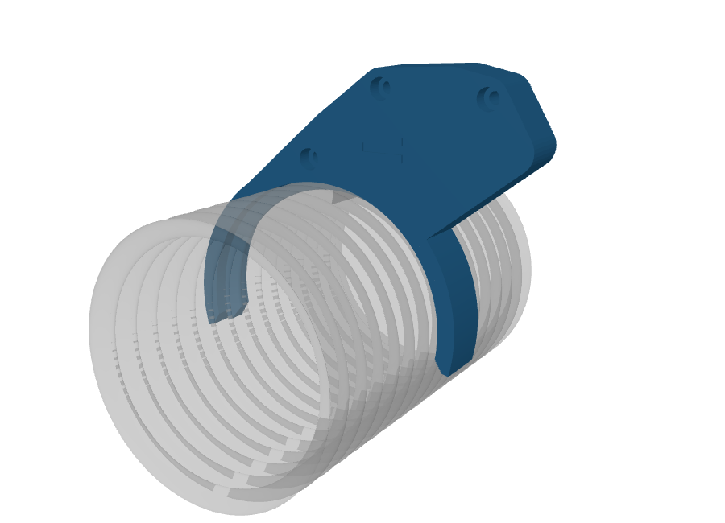

# Corta-tubos em C — conduta VMC corrugada Ø75 (HEATPEX 75/63)

## Imprimir

| Ficheiro | Conteúdo |
|---|---|
| `prato_A_B.stl` | as duas metades num só prato (106 × 172 mm), já orientadas |
| `meia_A.stl` / `meia_B.stl` | as mesmas metades em ficheiros separados |

- **Material:** PETG ou ASA.
- **Definições:** camada de 0,2 mm, 4 perímetros, 30–40 % de enchimento, **sem suportes**.
- **Pé de elefante:** active a compensação (0,15–0,2 mm).
- **Orientação:** face exterior na mesa, rebaixo da lâmina para cima.

## Material necessário

- 1 lâmina trapezoidal de x-ato standard (61 × 19 × 0,6 mm).
- 3 parafusos M3 × 10 (DIN 912) e 3 porcas M3.

## Montagem

1. Pouse a lâmina no rebaixo da metade A, com o gume virado para o tubo.
2. Feche com a metade B. Coloque as porcas nos sextavados de B e aperte os 3 parafusos.

## Uso

1. Encaixe a ferramenta de lado no tubo, com a guia dentro do vale onde quer cortar. A ponta da lâmina fura o vale.
2. Rode no **sentido da seta gravada** (horário, visto pela metade A). Uma a duas voltas chegam.
3. Quando a lâmina perder o fio, vire-a para usar o outro canto. Depois, substitua-a.

## Geometria

- **Guia:** fica no mesmo vale do corte, por isso a ferramenta funciona com qualquer passo de corrugado. Tem 2,5 mm na ponta, 3 mm abaixo da crista, e flancos a cerca de 50° até ao anel (imprime sem suportes).
- **Anel:** apoia nas cristas dos dois lados do vale e mantém o corte perpendicular.
- **Furo nas cristas:** Ø76,3, ou seja crista de 75,5 mais 0,4 mm de folga. Serve tubos de 75 e de 76.
- **Lâmina:** a ponta fica no Ø61,3, 0,6 mm abaixo do Ø interior de 62,5. Fica exposta 4,1 mm abaixo da guia.

## Afinar (`python3 corta_tubos.py …`, requer `pip install manifold3d numpy`)

| Sintoma | Parâmetro a mudar |
|---|---|
| Abana no tubo | `--crista 75` |
| Não entra ou está duro | `--crista 76` ou `--abraco 200` |
| Sai sozinho | `--abraco 220` |
| Não corta até ao fim | `--sobrecorte 1.0` |
| A guia não entra no vale | `--guia_larg 2.0` ou `--guia_prof 2.5` |

## Segurança

- Com a ferramenta fora do tubo, a ponta da lâmina fica exposta cerca de 4 mm dentro do C. Não meta os dedos no C.
- Desmonte a lâmina para guardar a ferramenta.

