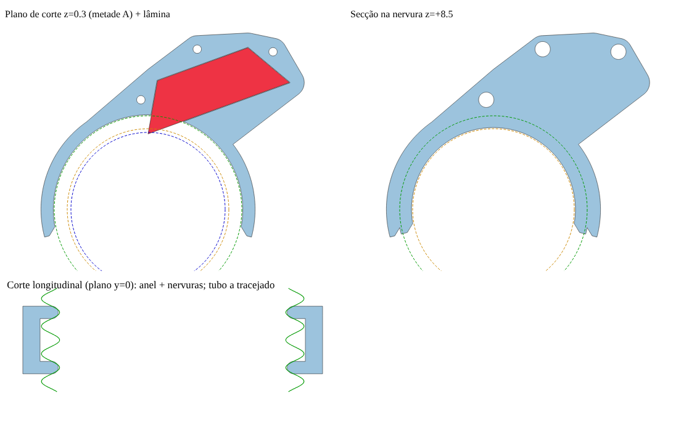

# Corta-tubos em C — conduta VMC corrugada Ø75 (HEATPEX 75/63)


## Peças

| Ficheiro | O que é | Impressão |
|---|---|---|
| `teste_encaixe.stl` | anel com nervura + 7 pentes de passo (7,0 a 10,0 mm) | **imprimir primeiro** · procedimento em `ficha_teste.pdf` |
| `meia_A.stl` | metade com rebaixo da lâmina e escareados M3 | já orientada: face exterior na mesa |
| `meia_B.stl` | metade tampa com alojamento das porcas M3 | já orientada: face exterior na mesa |

PETG ou ASA · camada 0,2 mm · 4 perímetros · 30–40 % de enchimento · **sem suportes** (nervuras e degraus virados para cima).

Ferragens: 1 lâmina trapezoidal de x-ato standard (61 × 19 × 0,6 mm) e 3 parafusos M3 × 14 (DIN 912) com porcas M3.

## Medidas assumidas (CONFIRMAR com paquímetro)

| Parâmetro | Valor por defeito | Origem |
|---|---|---|
| `--crista` Ø exterior nas cristas | 76,0 | ficha Heatpex Aria (76/62,5) |
| `--vale` Ø exterior no fundo do vale | 65,5 | estimado |
| `--interior` Ø interior | 62,5 | ficha Heatpex Aria |
| `--passo` passo do corrugado | 8,0 | **estimado: medir 10 passos e dividir por 10** |

Gerar de novo com as medidas reais:

```
pip install manifold3d numpy
python3 corta_tubos.py --crista 75.8 --vale 65.2 --interior 62.5 --passo 8.4
```

## Validação com a peça de teste (ver `ficha_teste.pdf`)

1. **Pentes**: o pente cujos 8 dentes entram todos nos vales indica o passo real.
2. **Anel**: tem de encaixar de lado com um "clique" leve e rodar sem folga visível. Se estiver duro, aumente `--folga` ou baixe `--abraco` (210°). Se tiver folga, faça o contrário.

## Montagem e uso

1. Pouse a lâmina no rebaixo da metade A, com o gume virado para o tubo. A ponta fica dentro do C.
2. Feche com a metade B. Coloque as porcas nos sextavados de B e aperte os 3 parafusos M3.
3. Encaixe o tubo de lado. As nervuras entram nos vales vizinhos e a ponta da lâmina fura o vale central.
4. Rode a ferramenta no **sentido da seta gravada** (horário, visto pela metade A). Uma a duas voltas chegam.
5. Quando a lâmina perder o fio, vire-a ao contrário para usar o outro canto. Depois, substitua-a.

Profundidade de corte: a ponta passa 0,6 mm abaixo do Ø interior (ajusta-se com `--sobrecorte`). O gume ataca a 20° da tangente (`--lam_ang`), o que dá um corte em puxão.

## Segurança

- Com a ferramenta fora do tubo, a ponta da lâmina fica exposta cerca de 7 mm dentro do C. Não meta os dedos no C.
- Desmonte a lâmina para guardar ou transportar a ferramenta.


